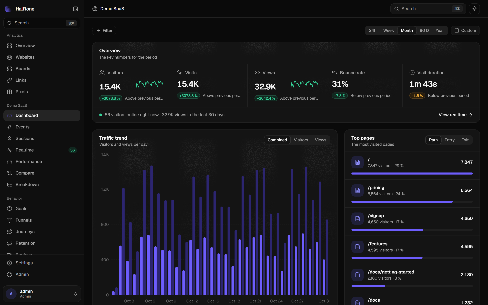
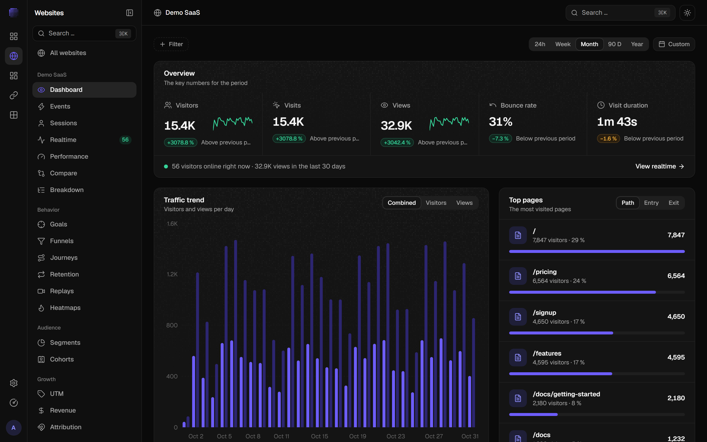
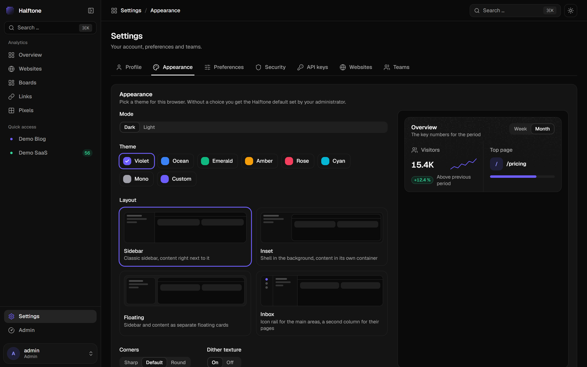

<p align="center">
  
</p>

<h1 align="center">Halftone</h1>

<p align="center"><b>See your traffic in dots.</b><br>
Privacy-focused web analytics you host yourself: every Umami feature in a calm, modern dashboard
with themes, layouts and your own branding.</p>

<p align="center">
  
</p>

## What it is

Halftone is a fork of [Umami](https://github.com/umami-software/umami) with a completely new frontend in
[`dashboard/`](dashboard), built with **TanStack Start**, **React 19**, **Tailwind CSS v4**, **shadcn/ui on Base UI**
and **ReUI** components. Umami stays the analytics engine: the tracker script, data collection, PostgreSQL storage
and the REST API are unchanged, so existing Umami installs, tracking snippets and data keep working.

## Features

- **Traffic** – visitors, visits, views, bounce rate and visit duration with filters (click any row to filter),
  presets and custom ranges, period and year-over-year comparison, breakdowns, web vitals
- **Events and sessions** – event charts and properties, every session as a timeline, weekly heat grid
- **Reports** – goals, funnels, journeys, retention, UTM, revenue and attribution
- **Replays and heatmaps** – session recordings with a built-in player, click and scroll heatmaps
- **Segments and cohorts**, **boards** (custom dashboards, compatible with Umami's board format),
  **short links** and **tracking pixels**
- **Teams, admin, API keys, two-factor sign-in** and public **share pages**
- **Make it yours** – seven themes or any accent colour, corner styles, the dither texture on or off,
  four app layouts (sidebar, inset, floating, inbox), and instance branding with your own name and logo

<p align="center">
  
  
</p>

## Self-hosting with Docker

```bash
git clone https://github.com/Brain2k-0005/halftone.git
cd halftone
cp .env.halftone.example .env        # set POSTGRES_PASSWORD, APP_SECRET, UMAMI_PUBLIC_URL
docker compose -f docker-compose.halftone.yml --env-file .env up -d
```

This starts PostgreSQL, the Umami API (`ghcr.io/umami-software/umami:3.4.1`, port 3000) and the Halftone
dashboard (port 3100). Sign in with `admin` / `umami` and change the password right away.

The API container must be reachable by your visitors' browsers, because it serves the tracking script,
receives the events and answers short links and pixels. Put both behind your reverse proxy, for example
`stats.example.com` → dashboard and `api.stats.example.com` → API, and set `UMAMI_PUBLIC_URL` to the API's public URL.

Add the tracking code from **Website → Settings → Tracking code** to your site.

## Deploying on Vercel

1. Deploy the Umami API as described in the [Umami docs](https://umami.is/docs) with a Postgres database
   from the Vercel Marketplace (e.g. Neon), and set `DISABLE_UI=1`.
2. Create a second Vercel project with `dashboard/` as the root directory and set
   `UMAMI_API_URL` (`https://<api>/api`), `UMAMI_PUBLIC_URL` (`https://<api>`) and optionally `UMAMI_TIMEZONE`.
3. The file system is read-only on Vercel, so set branding with environment variables:
   `BRAND_NAME`, `BRAND_ACCENT` (`#rrggbb`), `BRAND_PRESET`, `BRAND_LOGO_URL`.

## Configuration (dashboard)

| Variable           | Default                     | Purpose                                                        |
| ------------------ | --------------------------- | -------------------------------------------------------------- |
| `UMAMI_API_URL`    | `http://localhost:3000/api` | Where the dashboard server reaches the Umami API               |
| `UMAMI_PUBLIC_URL` | origin of `UMAMI_API_URL`   | Public URL of the API (tracking snippet, short links, pixels)  |
| `UMAMI_TIMEZONE`   | server time zone            | Time zone for grouping chart data                              |
| `BRANDING_FILE`    | `data/branding.json`        | Where Admin → Branding is stored                               |
| `BRAND_NAME`, `BRAND_ACCENT`, `BRAND_PRESET`, `BRAND_LOGO_URL` | – | Branding defaults (and the only source on read-only hosts) |

## Development

```bash
# Umami API (repository root)
pnpm install && pnpm dev            # http://localhost:3000

# Dashboard
cd dashboard && npm install && npm run dev   # http://localhost:3100
```

See [`dashboard/README.md`](dashboard/README.md) for the architecture.

## Credits and license

Halftone is built on [Umami](https://umami.is) by Umami Software, Inc. and is not affiliated with or
endorsed by them. Both are released under the [MIT License](LICENSE). The original Umami readme is kept in
[`docs/UMAMI-README.md`](docs/UMAMI-README.md).
